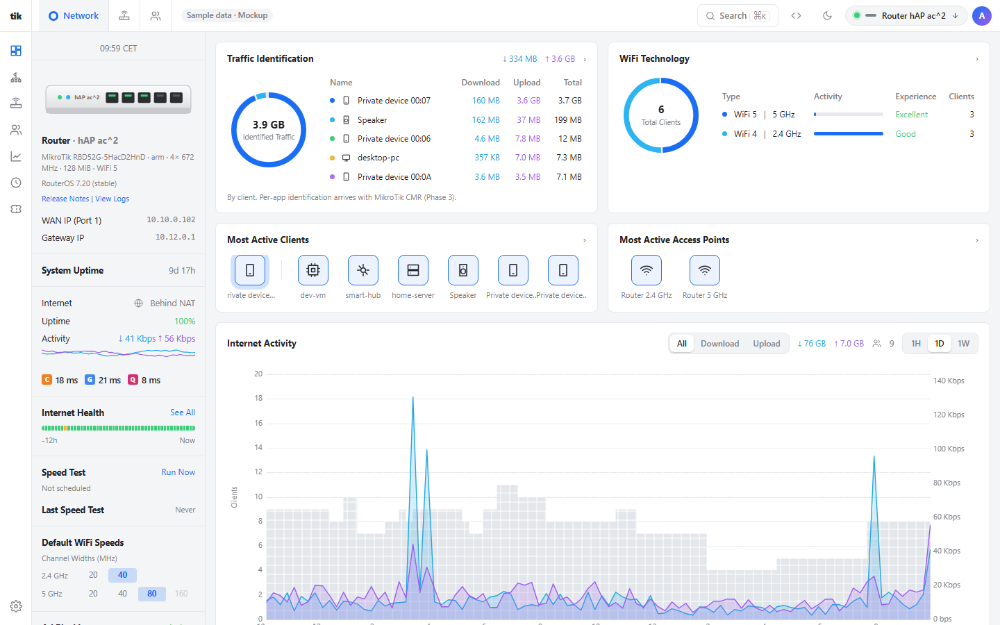
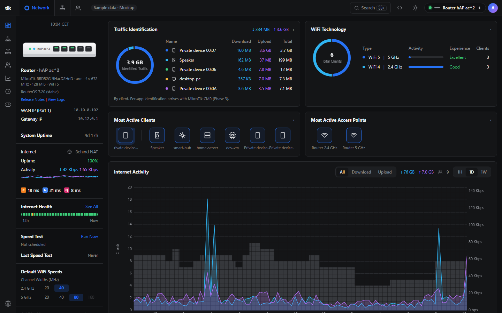
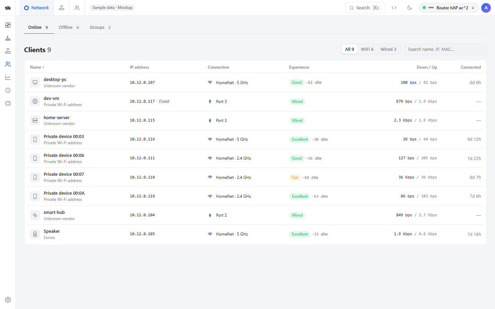
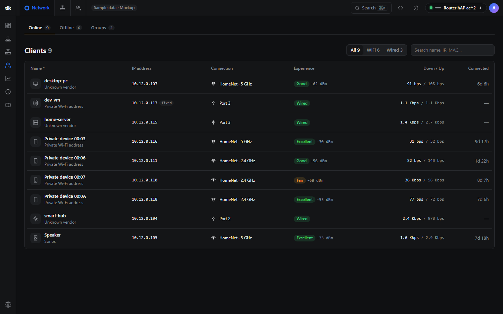
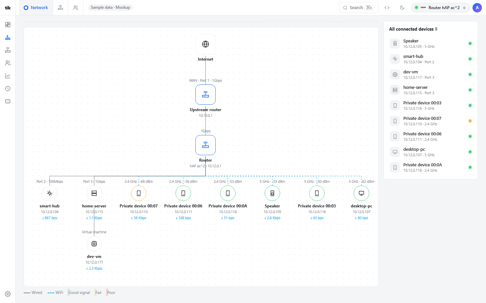
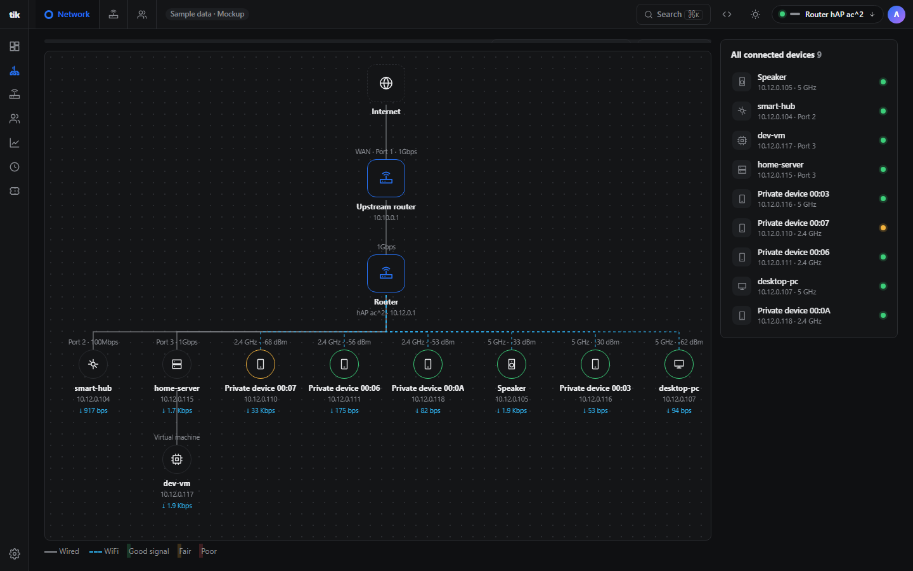
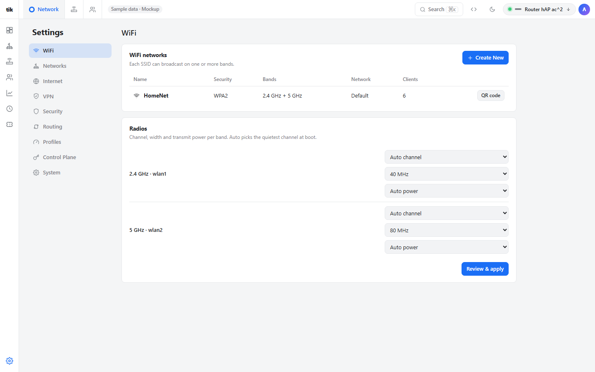
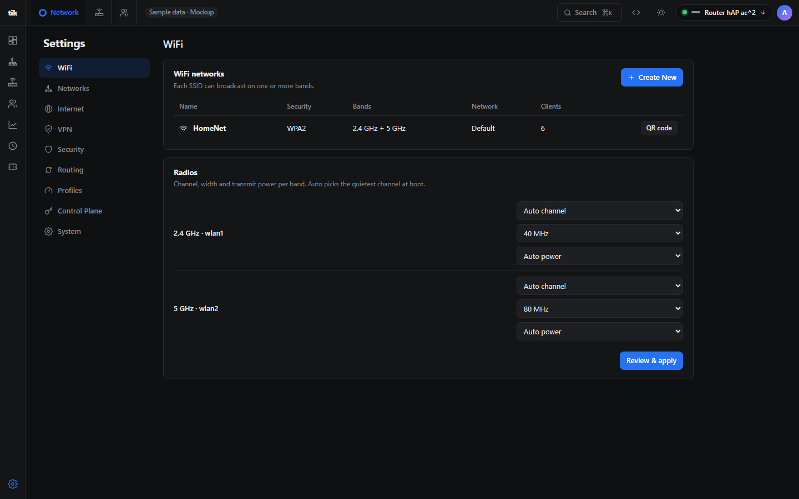
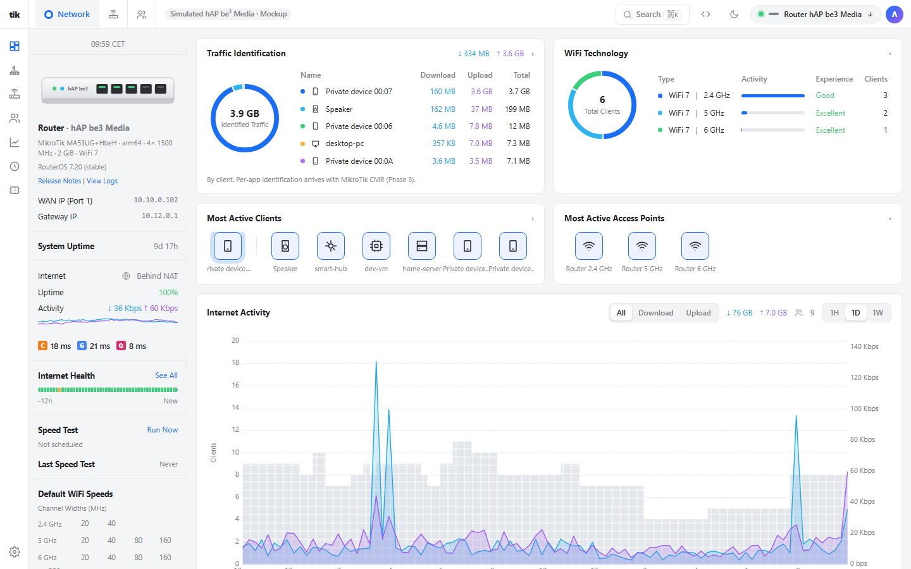

<a id="readme-top"></a>

<div align="center">
  <a href="https://github.com/MatejMa2ur/tikontrol">
    
  </a>

  <h3 align="center">tikontrol</h3>

  <p align="center">An independent, UniFi-inspired management UI for MikroTik RouterOS</p>

[![CI][ci-shield]][ci-url] [![Image][image-shield]][image-url] [![Last commit][commit-shield]][commit-url]<br>
[![Rust][Rust]][Rust-url] [![Svelte][Svelte]][Svelte-url] [![TypeScript][TypeScript]][TypeScript-url] [![Vite][Vite]][Vite-url]

  <p align="center">
    <a href="docs/INSTALL.md"><strong>Install</strong></a>
    &middot;
    <a href="docs/PLAN.md">Docs</a>
    &middot;
    <a href="https://github.com/MatejMa2ur/tikontrol/issues/new?labels=bug">Report Bug</a>
    &middot;
    <a href="https://github.com/MatejMa2ur/tikontrol/issues/new?labels=enhancement">Request Feature</a>
  </p>
</div>

<table>
  <tr>
    <td>&nbsp;<strong>Runs on</strong></td>
    <td>Your MikroTik router, or any Docker host</td>
  </tr>
  <tr>
    <td>&nbsp;<strong>Safe</strong></td>
    <td>Read-only by default; changes undo themselves unless confirmed</td>
  </tr>
  <tr>
    <td>&nbsp;<strong>Install</strong></td>
    <td><a href="docs/INSTALL.md">One paste</a> in the router terminal</td>
  </tr>
  <tr>
    <td>&nbsp;<strong>Status</strong></td>
    <td>Early development, <a href="docs/FEATURES.md">progress</a></td>
  </tr>
</table>

<picture>
  <source media="(prefers-color-scheme: dark)" srcset="docs/images/dashboard-dark.png">
  
</picture>

<!-- TABLE OF CONTENTS -->
<details>
  <summary>Table of Contents</summary>
  <ol>
    <li>
      <a href="#about-the-project">About The Project</a>
      <ul>
        <li><a href="#screenshots">Screenshots</a></li>
      </ul>
    </li>
    <li>
      <a href="#getting-started">Getting Started</a>
      <ul>
        <li><a href="#on-your-router">On your router</a></li>
        <li><a href="#for-development">For development</a></li>
      </ul>
    </li>
    <li><a href="#usage">Usage</a></li>
    <li><a href="#project-structure">Project Structure</a></li>
    <li><a href="#hardware">Hardware</a></li>
    <li><a href="#roadmap">Roadmap</a></li>
    <li><a href="#contributing">Contributing</a></li>
    <li><a href="#license">License</a></li>
    <li><a href="#trademarks">Trademarks</a></li>
    <li><a href="#contact">Contact</a></li>
    <li><a href="#acknowledgments">Acknowledgments</a></li>
  </ol>
</details>

<!-- ABOUT THE PROJECT -->
## About The Project

tikontrol is a clean, opinionated web UI for MikroTik routers, inspired by how UniFi Network organises a home network: dashboard, client list, networks, Wi-Fi, firewall and port forwarding, VPN, topology and alerts.

- Runs on the router itself as a RouterOS App, or on any home server. No cloud, no account, no outbound calls.
- Talks to RouterOS over the encrypted API (API-SSL) with its own least-privilege user. RouterOS stays the source of truth, and WinBox/WebFig keep working next to it.
- Other MikroTik devices on the LAN (APs, switches) show up as neighbours. Managing them from the same place is planned.

**Non-goals**

- Replacing WinBox for advanced config. Raw access stays one click away.
- Features that RouterOS can't back, such as real DPI or a native mobile app. See [RESEARCH.md](docs/RESEARCH.md).

> [!NOTE]
> tikontrol is in **early development**. It runs on real router data, read-only by default. Most features work but have not had their full test pass yet.

<p align="right">(<a href="#readme-top">back to top</a>)</p>

### Screenshots

tikontrol has a light and a dark theme. These screenshots use fictional sample data, so no real network appears here. To refresh them, run the UI in development mode, add `?theme=light` or `?theme=dark` to the URL and capture each page.

| Light | Dark |
| --- | --- |
|  |  |
|  |  |
|  |  |
|  |  |

The hAP be³ Media preview is simulated from MikroTik's spec sheet:



<p align="right">(<a href="#readme-top">back to top</a>)</p>

<!-- GETTING STARTED -->
## Getting Started

### On your router

One paste in the router terminal installs tikontrol as a RouterOS App. [INSTALL.md](docs/INSTALL.md) lists what you need (RouterOS 7.22+, the `container` package, an ext4 USB stick or microSD card) and every change the script makes.

```
/tool/fetch url="https://raw.githubusercontent.com/MatejMa2ur/tikontrol/master/deploy/install.rsc" dst-path=tikontrol-install.rsc; /import tikontrol-install.rsc
```

Then open `https://tikontrol.lan:8443` (or **App → tikontrol** in WebFig) and sign in with your MikroTik admin account. tikontrol creates its own read-only user on the router and never stores your admin password. New versions install automatically, and your settings survive updates.

To run it on a home server with Docker instead, see [DEPLOY.md](docs/DEPLOY.md).

### For development

You need Node.js 24+ and a current Rust toolchain.

1. Clone the repo
   ```sh
   git clone https://github.com/MatejMa2ur/tikontrol.git
   cd tikontrol
   ```
2. UI only, on fictional sample data, with hot reload at <http://localhost:5173>
   ```sh
   cd src/ui && npm install && npm run dev
   ```
3. The full app: build the UI, then run the server in demo mode (no router needed) at <https://localhost:8443>
   ```sh
   (cd src/ui && npm run build)
   cd src/server && TIK_DEMO=../ui/src/lib/sample.json cargo run
   ```
   The setup token for the first admin account is printed in the terminal. Without `TIK_DEMO`, the setup page connects to a real router.

Optional: `src/scripts/snapshot.py > src/ui/src/lib/snapshot.json` takes a read-only snapshot of your own router over SSH for the dev UI. It is gitignored and never part of a build.

<p align="right">(<a href="#readme-top">back to top</a>)</p>

<!-- USAGE -->
## Usage

- **Dashboard, Clients, Devices and topology, Ports, Insights and Events**, plus Settings for Wi-Fi, networks, internet and VPN: live data from the router, refreshed in the background. Polling slows down by itself when the router's CPU is busy.
- **Read-only by default.** To allow changes, go to **Settings → Control plane** and switch tikontrol to read & write. Every change is then shown before it is applied and goes through Safe apply: the router undoes it by itself after 5 minutes unless you confirm from the browser that everything still works.
- **Themes:** Settings → System → Appearance has light, dark and auto, plus one-click looks (Controller, Router admin, Minimal).
- **AI assistants:** an optional MCP endpoint lets an assistant read the network, with its own API keys. Nothing is sent anywhere unless you set it up.
- Make, model and Wi-Fi capabilities are detected from what the router reports, so there is nothing to set up per model. `?device=be3` in the dev UI previews a hAP be³ Media.

Run the tests from the repo root with `node --test tests/*.test.ts` and, in `src/server`, `cargo test`.

<p align="right">(<a href="#readme-top">back to top</a>)</p>

<!-- PROJECT STRUCTURE -->
## Project Structure

```
deploy/        Router installer and uninstaller, RouterOS App definition
docs/          Install and deploy guides, plan, research, feature tracker, OpenAPI spec, screenshots
src/server/    Rust server: RouterOS API client, auth, Safe apply, MCP; embeds the built UI
src/ui/        Svelte 5 + Vite web UI
src/scripts/   Router snapshot, anonymiser, OUI table and progress counter
tests/         UI logic and installer tests
Containerfile  Multi-arch image (arm/v7, arm64, amd64), published to ghcr.io
```

<p align="right">(<a href="#readme-top">back to top</a>)</p>

<!-- HARDWARE -->
## Hardware

tikontrol is one small binary (a few MB, with the UI built in) and is capped at 48 MB of RAM on the router.

| | hAP ac² | hAP be³ Media |
| --- | --- | --- |
| Architecture | ARM 32-bit | ARM 64-bit |
| RAM | 128 MiB | 2 GB |
| Storage | 16 MiB flash + USB stick | 512 MB NAND + microSD |
| Wi-Fi | Legacy `wireless` package | WiFi 7, new `wifi` package |
| tikontrol | Runs on the router (container on a USB stick) | Planned; previewed with simulated data |

Any router that can run containers works: see the list in [INSTALL.md](docs/INSTALL.md#what-you-need).

<p align="right">(<a href="#readme-top">back to top</a>)</p>

<!-- ROADMAP -->
## Roadmap

**Progress is tracked in [FEATURES.md](docs/FEATURES.md)**: every UniFi page and feature, what backs it on MikroTik, and its status. See [PLAN.md](docs/PLAN.md) for the plan and [RESEARCH.md](docs/RESEARCH.md) for prior art and platform limits. [FEASIBILITY.md](docs/FEASIBILITY.md) is the latest study of what is possible, with its source notes in [docs/research](docs/research).

- [x] Phase 0: Dev environment, connect to the router
- [x] Phase 1: Read-only dashboard and clients (built; final test pass pending)
- [ ] Phase 2: Safe writes (in progress)
- [ ] Phase 3: Structural changes through Safe apply
- [ ] Phase 4: Fleet management: several routers and access points from one place

<p align="right">(<a href="#readme-top">back to top</a>)</p>

<!-- CONTRIBUTING -->
## Contributing

Bug reports and ideas are welcome through [issues](https://github.com/MatejMa2ur/tikontrol/issues). Read [CLAUDE.md](CLAUDE.md) first: it holds the security rules every change follows, and no real values from anyone's network may be committed. If a change moves a feature to a new state, update its Status cell in [FEATURES.md](docs/FEATURES.md) and run `src/scripts/progress.py`.

<p align="right">(<a href="#readme-top">back to top</a>)</p>

<!-- LICENSE -->
## License

No license has been chosen yet, so all rights are reserved for now. Ask before reusing the code.

<p align="right">(<a href="#readme-top">back to top</a>)</p>

<!-- TRADEMARKS -->
## Trademarks

tikontrol is an independent project. It is not affiliated with, endorsed by or sponsored by Ubiquiti Inc. or MikroTik.

UniFi is a trademark of Ubiquiti Inc. MikroTik, RouterOS and WinBox are trademarks of their respective owner. These names are used only to describe what tikontrol works with and what inspired it. tikontrol is built from public documentation and does not include Ubiquiti or MikroTik code, logos or product images.

<p align="right">(<a href="#readme-top">back to top</a>)</p>

<!-- CONTACT -->
## Contact

Matej Mazúr - [github.com/MatejMa2ur](https://github.com/MatejMa2ur)

Project Link: [https://github.com/MatejMa2ur/tikontrol](https://github.com/MatejMa2ur/tikontrol)

<p align="right">(<a href="#readme-top">back to top</a>)</p>

<!-- ACKNOWLEDGMENTS -->
## Acknowledgments

- [nasnet-panel](https://github.com/nasnet-community/nasnet-panel)
- [uPlot](https://github.com/leeoniya/uPlot)
- [Best-README-Template](https://github.com/othneildrew/Best-README-Template)

<p align="right">(<a href="#readme-top">back to top</a>)</p>

<!-- MARKDOWN LINKS & IMAGES -->
[ci-shield]: https://img.shields.io/github/actions/workflow/status/MatejMa2ur/tikontrol/ci.yml?branch=master&style=for-the-badge&label=CI
[ci-url]: https://github.com/MatejMa2ur/tikontrol/actions/workflows/ci.yml
[image-shield]: https://img.shields.io/github/actions/workflow/status/MatejMa2ur/tikontrol/image.yml?branch=master&style=for-the-badge&label=image
[image-url]: https://github.com/MatejMa2ur/tikontrol/pkgs/container/tikontrol
[commit-shield]: https://img.shields.io/github/last-commit/MatejMa2ur/tikontrol?style=for-the-badge
[commit-url]: https://github.com/MatejMa2ur/tikontrol/commits/master
[Svelte]: https://img.shields.io/badge/Svelte-FF3E00?style=for-the-badge&logo=svelte&logoColor=white
[Svelte-url]: https://svelte.dev/
[TypeScript]: https://img.shields.io/badge/TypeScript-3178C6?style=for-the-badge&logo=typescript&logoColor=white
[TypeScript-url]: https://www.typescriptlang.org/
[Vite]: https://img.shields.io/badge/Vite-646CFF?style=for-the-badge&logo=vite&logoColor=white
[Vite-url]: https://vite.dev/
[Rust]: https://img.shields.io/badge/Rust-000000?style=for-the-badge&logo=rust&logoColor=white
[Rust-url]: https://www.rust-lang.org/
